# Modelo Entidade-Relacionamento — UnB RU

Diagrama do schema implementado (`db/schema.rb`, versão `2026_11_15_201917`), com os nomes de
tabelas e colunas como estão no código. As diferenças em relação ao modelo planejado na Sprint 1
estão listadas abaixo do diagrama.

```mermaid
erDiagram
    users ||--o{ recargas : realiza
    users |o--o{ acessos : "passa na catraca"
    users ||--o{ inscricoes_fastpass : "se inscreve"
    users ||--o{ notificacoes : recebe
    funcionarios ||--o{ acessos : "opera o terminal"
    restaurantes ||--o{ catracas : possui
    restaurantes ||--o{ turnos : define
    restaurantes |o--o{ acessos : "ponto de acesso"
    catracas |o--o{ acessos : registra
    turnos ||--o{ time_frames : "é dividido em"
    turnos ||--o{ sorteios : "tem um por data"
    sorteios ||--o{ inscricoes_fastpass : "reúne"
    time_frames ||--o{ inscricoes_fastpass : recebe
    inscricoes_fastpass ||--o| notificacoes : gera
    inscricoes_fastpass |o--o{ acessos : "é validada em"

    users {
        int id PK
        string nome
        string matricula UK "estudante"
        string password
        int saldo_centavos "default 0"
        datetime created_at
        datetime updated_at
    }
    funcionarios {
        int id PK
        string nome
        string matricula UK "operador ou administrador"
        string password
        boolean administrador "default false"
        datetime created_at
        datetime updated_at
    }
    tarifas {
        int id PK
        int valor_centavos "vigente = ultima cadastrada, padrao 450"
        datetime created_at
        datetime updated_at
    }
    recargas {
        int id PK
        int user_id FK
        int quantidade "refeicoes"
        int valor_centavos "quantidade x tarifa vigente"
        string metodo_pagamento "pix | cartao"
        datetime created_at
        datetime updated_at
    }
    restaurantes {
        int id PK
        string nome UK
        datetime created_at
        datetime updated_at
    }
    catracas {
        int id PK
        int restaurante_id FK
        string nome "unico por restaurante"
        datetime created_at
        datetime updated_at
    }
    acessos {
        int id PK
        int user_id FK "nulo se identificacao desconhecida"
        int funcionario_id FK "operador"
        int restaurante_id FK "opcional"
        int catraca_id FK "opcional, do mesmo restaurante"
        int inscricao_fastpass_id FK "opcional, on_delete nullify"
        string identificacao "matricula lida no QR Code"
        string status "liberado | confirmado | saldo_insuficiente | nao_encontrado | fora_do_time_frame | sem_fastpass | fastpass_utilizado"
        string modalidade "comum | fastpass, default comum"
        string refeicao "cafe_da_manha | almoco | jantar"
        int valor_centavos "tarifa vigente, debitada so ao confirmar"
        datetime created_at
        datetime updated_at
    }
    menus {
        int id PK
        date served_on "unico com meal_type"
        string meal_type "cafe_da_manha | almoco | jantar"
        string standard_dish
        string ovolacto_dish
        string vegan_dish
        string extra_option
        string salads
        string garnish
        string side_dishes
        string dessert
        string beverage
        string soup
        boolean has_toast "default false"
        datetime created_at
        datetime updated_at
    }
    turnos {
        int id PK
        int restaurante_id FK
        string nome "unico por restaurante"
        int hora_inicio_min "minutos desde 00:00"
        int hora_fim_min "minutos desde 00:00"
        int duracao_time_frame_min "opcional"
        datetime created_at
        datetime updated_at
    }
    time_frames {
        int id PK
        int turno_id FK
        int numero "unico por turno"
        int hora_inicio_min
        int hora_fim_min
        datetime created_at
        datetime updated_at
    }
    sorteios {
        int id PK
        int turno_id FK
        date data_refeicao "unico com turno_id"
        string status "aberto | encerrado | realizado, default aberto"
        datetime created_at
        datetime updated_at
    }
    inscricoes_fastpass {
        int id PK
        int user_id FK "unico com sorteio_id"
        int sorteio_id FK
        int time_frame_id FK
        string status "inscrito | sorteado | nao_sorteado | utilizado, default inscrito"
        datetime created_at
        datetime updated_at
    }
    notificacoes {
        int id PK
        int user_id FK
        int inscricao_fastpass_id FK "unico"
        string tipo "contemplado | nao_contemplado"
        string mensagem
        boolean lida "default false"
        datetime enviada_em
        datetime created_at
        datetime updated_at
    }
```

Observações sobre os relacionamentos:

- `acessos.user_id`, `restaurante_id`, `catraca_id` e `inscricao_fastpass_id` são opcionais. Remover
  um usuário, restaurante, catraca ou inscrição anula a referência nos acessos (`dependent: :nullify`
  nos models; na FK de `inscricao_fastpass_id`, também `on_delete: :nullify`), para não apagar o
  histórico usado no extrato e nos relatórios. Um funcionário com acessos não pode ser removido
  (`restrict_with_error`).
- `menus` e `tarifas` não têm chaves estrangeiras: o cardápio é escolhido pela data e pelo tipo de
  refeição do horário atual, e a tarifa vigente é a última cadastrada.

## Diferenças em relação ao modelo original

Nomes:

- `USUARIO` com `papel` virou duas tabelas: `users` (estudantes) e `funcionarios` (operadores), com a
  coluna booleana `administrador` no lugar do papel `administrador`.
- As demais entidades usam o nome das tabelas do código, no plural: `RECARGA` → `recargas`,
  `RESTAURANTE` → `restaurantes`, `CATRACA` → `catracas`, `ACESSO` → `acessos`, `TURNO` → `turnos`,
  `TIME_FRAME` → `time_frames`, `SORTEIO` → `sorteios`, `FASTPASS_INSCRICAO` → `inscricoes_fastpass`
  (coluna `inscricao_fastpass_id`), `NOTIFICACAO` → `notificacoes`.
- `CARDAPIO` e `ITEM_CARDAPIO` viraram uma única tabela, `menus`, que veio da base de banco de dados
  com nomes em inglês: uma linha por data (`served_on`) e refeição (`meal_type`), com os pratos e
  acompanhamentos em colunas de texto, em vez de itens com categoria, variante e ordem. Também não
  há o relacionamento `TURNO }o..o{ CARDAPIO`: a refeição do momento é definida por faixas de
  horário fixas (`Menu.current_meal_type`).

- Colunas renomeadas para o padrão do Rails e do código: `usuario_id` → `user_id` (em `recargas`,
  `acessos`, `inscricoes_fastpass` e `notificacoes`) e `criado_em` → `created_at`. Em `recargas`,
  `quantidade_refeicoes` → `quantidade`, `metodo` → `metodo_pagamento` (valores `pix` e `cartao`, em
  vez de `cartao_credito`) e `valor` → `valor_centavos`. Em `menus`, o `dia_semana` do `CARDAPIO`
  virou uma data (`served_on`).

Tipos:

- Dinheiro em centavos inteiros (`saldo_centavos`, `valor_centavos`), não `decimal`.
- Horários de turnos e time-frames em minutos desde a meia-noite (`hora_inicio_min`,
  `hora_fim_min`), não `time`, para não depender de fuso horário.
- Senhas na coluna `password` de `users` e `funcionarios`, comparada diretamente, em vez de
  `password_digest`.

Tabelas novas:

- `tarifas`: o valor da refeição deixou de ser fixo (padrão R$ 4,50 enquanto nenhuma tarifa é
  cadastrada) e é usado na recarga e no débito do acesso.

Mudanças em `acessos`:

- `resultado` virou `status`, com os valores do fluxo implementado: a leitura fica `liberado` e só
  vira `confirmado` (com o débito) quando a passagem é confirmada; os bloqueios são
  `saldo_insuficiente`, `nao_encontrado`, `fora_do_time_frame`, `sem_fastpass` e
  `fastpass_utilizado`. Não existem `bloqueado_fora_janela` nem `bloqueado_reentrada` na entrada
  comum.
- `turno_id` não existe: `refeicao` guarda café da manhã, almoço ou jantar, pelo horário da leitura.
- `data_hora` é o `created_at`; `valor_debitado` virou `valor_centavos` (a tarifa vigente na leitura,
  debitada só quando o status é `confirmado`).
- Novas: `funcionario_id` (o operador que fez a leitura), `identificacao` (o que foi lido, mesmo
  quando não corresponde a nenhum estudante) e `restaurante_id` (o ponto de acesso configurado).

Fora do escopo (não implementado):

- `SESSAO_OPERACAO`: a sessão do operador e o ponto de acesso escolhido (restaurante e catraca) ficam
  na sessão HTTP (`session[:restaurante_id]`, `session[:catraca_id]`); cada acesso guarda o
  funcionário, o restaurante e a catraca.
- Pity e bloqueio do FastPass: `fastpass_derrotas_consecutivas`, `fastpass_bloqueado_ate` (bloqueio de
  24h) e `peso_sorteio`. O algoritmo que escolhe os sorteados também não foi implementado: o sorteio é
  marcado `realizado` uma hora antes do turno (o que encerra as inscrições) e as inscrições que já têm
  resultado são notificadas, mas nada muda uma inscrição de `inscrito` para `sorteado` ou
  `nao_sorteado` (nos testes, isso é feito pelos passos do Cucumber).
- `sorteios`: `executado_em` e `versao_algoritmo`. O status ganhou o valor `encerrado`.
- `inscricoes_fastpass`: `codigo_passe` (o estudante é identificado pela matrícula) e os status
  `cancelado` e `nao_compareceu`.
- `turnos`: `tipo_refeicao` (o turno tem um `nome` livre), `ativo`, `fastpass_habilitado`,
  `tolerancia_atraso_min`, `antecedencia_min` e `trava_pontualidade`. A janela do time-frame é
  inclusiva nos dois limites, sem tolerância. `granularidade_min` virou `duracao_time_frame_min`.
- `time_frames`: `tipo` (lote ou pico), `cota_fastpass` e `ativo`.
- `catracas`: `numero`, `piso`, `status`, `modo_operacao` (`exclusivo_fastpass`) e `descricao`. A
  catraca tem só um `nome`, e a entrada do FastPass é um quadro separado no terminal do operador.
- `restaurantes`: `campus`, `localizacao`, `capacidade_ref_hora` e `capacidade_lugares`.
- `users`: `curso`.
- `recargas`: `status`, `codigo_pix` e `transacao_externa_id`. O pagamento é simulado: o QR Code e o
  código PIX são gerados na tela e não são guardados; a recarga é gravada e o saldo creditado na
  mesma transação.
